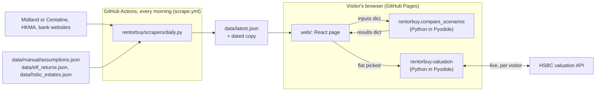

# Rent or Buy? (HK)

Should you buy a Hong Kong home, or rent it and invest the difference? An ECON3086 group project.

- `rentorbuy/calc/`: the calculator, pure Python. It runs in the browser through Pyodide.
- The calculator compares rent and buy under three Market Scenarios: the low end, middle and high end of a price and rent forecast fitted to 30 years of RVD indices (`rentorbuy/market_benchmarks.py`, statsmodels). The mortgage rate can be an H-plan or HSBC's (Small P) or BOCHK's (Big P) prime. A second tool estimates a home budget from income, existing monthly loan repayments and down-payment funds.
- Affordability uses the project's 50% debt-servicing cap, up to 30 years and non-first-time Hong Kong loan-to-value tiers. Its +2 percentage-point check is a what-if, because HKMA's official stress test is suspended: it shows the lower price that would fit at the higher rate. The estimate excludes purchase fees and mortgage-insurance premiums and is not bank approval.
- `rentorbuy/valuation.py`: picks a specific flat and gets HSBC's valuation, live from the visitor's browser.
- `rentorbuy/scrapers/`: daily scrapers (Midland estate prices and rents, with Centaline's asking prices when Midland refuses us; HKMA rates, each bank's prime rate, HKD new-fund time deposit rates), run by GitHub Actions.
- `rentorbuy/etf_returns.py`: past returns of the Tracker Fund (2800.HK) and SPY, worked out with pandas from monthly prices that `rentorbuy/scrapers/etf.py` downloads with yfinance. Run by hand every few months, not daily.
- `data/`: dated snapshots; `data/latest.json` is what the site reads. `data/manual/` holds hand-entered assumptions.
- `tests/`: hand-checked `assert` tests (`test_calc.py`, `test_valuation.py`, `test_daily.py`, `test_scrapers.py`, `test_banks.py`, `test_deposits.py`, `test_etf_returns.py`, `test_centaline.py`, `test_market_benchmarks.py`).
- `web/`: the website (React, Tailwind, shadcn/ui). It displays what Python returns and can print a localized, stand-alone comparison report to PDF.

## How it fits together



Each folder with rules of its own has a `README.md`: `rentorbuy/calc/`, `rentorbuy/scrapers/`, `data/` and `web/`.

See `CONTEXT.md` for the words we use, `docs/adr/` for why it is built this way, and `CONTRIBUTING.md` for how we work on it.

## Run it

```bash
uv run pytest                               # the tests (each file also runs alone: uv run python tests/test_calc.py)
uv run python -m rentorbuy.scrapers.daily   # scrape today's data
uv run python -m rentorbuy.scrapers.etf     # refresh ETF prices (Yahoo Finance) and returns, every few months
pnpm --dir web install && pnpm --dir web dev   # the site, at http://localhost:5173
pnpm --dir web test                            # the PDF report presentation tests
```

After running a comparison, choose **Save PDF report** and select **Save as PDF** in the browser's print dialog. The report uses the current language, shows the range across the three Market Scenarios with the middle one in detail, and includes the net-worth chart, inputs, costs, data sources and limitations.
