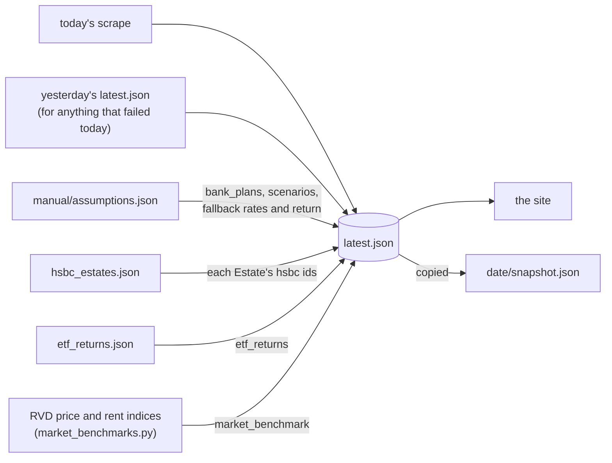

# data — the snapshots the site reads

> **摘要**：網站只讀 `latest.json`。佢由每朝嘅 GitHub Actions job 寫，唔好手改；想改入面啲數，就改 scraper。
> 人手輸入嘅假設放喺 `manual/assumptions.json`，標咗 `provisional` 嘅值要喺 present 之前換成真數。

| Path | Written by | When |
|---|---|---|
| `latest.json` | `rentorbuy/scrapers/daily.py` | every morning; the only file the site reads |
| `<date>/snapshot.json` | `rentorbuy/scrapers/daily.py` | same content as `latest.json`, kept one per day as history |
| `manual/assumptions.json` | by hand | bank plans, Market Scenarios, fallback rates, fallback Investment Return |
| `hsbc_estates.json` | `rentorbuy/scrapers/hsbc_estates.py`, by hand | when the Estate list changes |
| `etf/<ticker>.csv`, `etf_returns.json` | `rentorbuy/scrapers/etf.py`, by hand | every few months |

## What goes into `latest.json`

Top-level keys: `date`, `rates` (HIBOR, prime, `stale`), `bank_primes`, `estates`, `bank_plans`,
`scenarios`, `market_benchmark`, `deposits`, `deposit_ranking`, `investment_return`, `etf_returns`.
`market_benchmark` holds the price and rent forecasts for each Horizon from 1 to 30 years
(`price.growth_pct["10"]` = `{low, point, high}` in % a year); `scenarios` is the hand-entered fallback
the site uses when it is missing.
`web/src/lib/types.ts` is the shape the site expects.

## Rules that must hold

- Every scraped figure carries the date it was read (`scraped` on an Estate, `date` on a bank's rates),
  so the site can say how old it is.
- In `manual/assumptions.json`, a key starting with `_` is a note for people; `daily.py` drops it.
  `"provisional": true` marks a value the Finance teammates still have to check.

## Gotchas

- A local run of `daily.py` rewrites `latest.json` and today's folder. Leave those changes out of your commit.
- `daily.py` reads the old `latest.json` before writing the new one, so a hand edit there leaks into
  every later snapshot.
- `market_benchmark` is refitted every morning, but RVD publishes once a month, so it only changes
  when a new month comes out. If RVD fails, yesterday's forecast is kept.
- The dated folders are the history for checking the tool against past data. Keep them.
