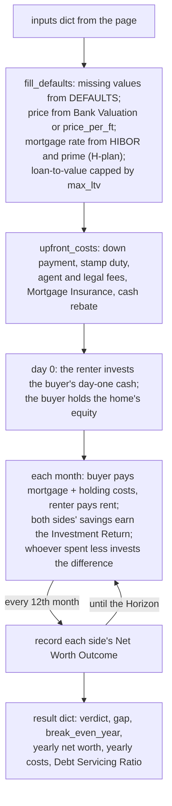

# calc — the buy-vs-rent maths

> **摘要**：成個系統所有計數都喺呢度。只用 Python 標準庫，所以同一份 code 喺瀏覽器（Pyodide）同普通 Python
> 都行到。網頁將 inputs dict 傳入 `compare()`，再畫返佢回傳嘅 dict；網頁本身唔計任何數。

**Does:** one Comparison, month by month (`comparison.py`), and its parts: stamp duty (`stamp_duty.py`),
mortgage rate, payment, loan-to-value cap and insurance (`mortgage.py`), buying and holding costs
(`buy_side.py`), rent and savings growth (`rent_side.py`), time deposit ranking (`deposits.py`).
**Does not:** fetch anything, read files, or format numbers for display.

## How one Comparison runs

`compare_scenarios` runs `compare` once per Market Scenario (pessimistic, neutral, optimistic), changing only
price and rent growth. That is what the page calls.

## Rules that must hold

- Standard library only. Modules here import each other and nothing else, or the site breaks in the browser.
- Both sides spend the same each month and the cheaper side invests the difference. That keeps the
  comparison fair; any new cost goes into `owner_cost` or `rent`, never outside the loop.
- Each Hong Kong rule (stamp duty table, loan-to-value caps) names its source in the docstring; the
  research is in `docs/research/hk-property-rules-2026-11.md`.
- Every function has hand-checked tests: `tests/test_calc.py`, and `tests/test_deposits.py` for `deposits.py`.

## Gotchas

- `INSURANCE_PREMIUM_RATES` in `mortgage.py` is provisional until the Finance teammates put in HKMC's table.
- In `fill_defaults`, `None` means "use the default", so the page sends `None` to ask for one.
  `rate_shift` is added after the mortgage rate is worked out, so it shifts a typed rate too.
- `yearly_costs` holds the first month of each year only, not a yearly total.
- `deposits.py` runs in the daily scraper (the ranking is saved in the snapshot), not on the page. It lives
  here because it is pure maths.
- Every name a result uses (Net Worth Outcome, Break-even Year…) is defined in `CONTEXT.md`.
