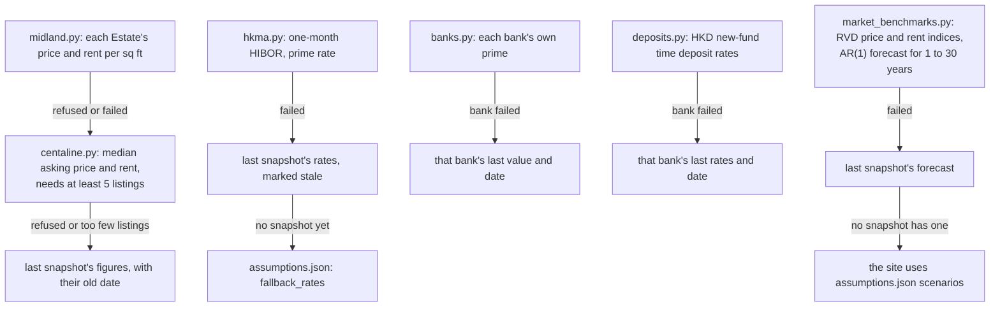

# scrapers — today's prices and rates

> **摘要**：GitHub Actions 每朝 09:00（香港時間）跑 `daily.py`，由 Midland（唔得就 Centaline）、HKMA 同各銀行網站攞數，
> 加埋人手假設，寫成 `data/latest.json`。網站自己唔會 scrape。任何一個來源失敗，都會用返上次嘅數，並且記低日期。

**Does:** fetch pages and APIs, parse them, combine them into one snapshot.
**Does not:** run in the browser, or calculate a Comparison (that is `rentorbuy/calc/`).

## What runs when

| Script | Run | Writes |
|---|---|---|
| `daily.py` | every morning, by `.github/workflows/scrape.yml` | `data/latest.json`, `data/<date>/snapshot.json` |
| `etf.py` | by hand, every few months | `data/etf/<ticker>.csv`, then `data/etf_returns.json` (via `rentorbuy/etf_returns.py`) |
| `hsbc_estates.py` | by hand, when `estates.py` changes | `data/hsbc_estates.json` |

## Where each figure comes from, and what happens when a source fails

Whichever box a figure ends in, `build_snapshot` in `daily.py` puts it in the snapshot. It also copies in the hand-entered bank plans and scenarios (`data/manual/assumptions.json`),
the ETF returns and each Estate's HSBC ids, and ranks the deposit rates with `rentorbuy/calc/deposits.py`.

## Rules that must hold

- Fetching and parsing are separate functions. Tests run the parsers on saved pages in `tests/fixtures/`
  (Midland on hand-built data), never on the live site.
- A 403, 405 or 429 (`BLOCKED`) means the site is refusing us: stop at once. Other failures may be retried.
  Read `docs/research/api-access-log.md` before running any scraper by hand.
- Every figure keeps the date it was read, so the site can say how old it is.
- Wait between pages (`pause`); Centaline's robots.txt asks for 1 second. Send `USER_AGENT` from `__init__.py`.

## Gotchas

- Midland refuses GitHub's servers (403), so on Actions most Estates come from Centaline. Those are asking
  prices, a bit above real sale prices; the snapshot marks them `"price_source": "centaline"`.
- HKMA blocked one of our connections after about 20 requests in two hours.
- `daily.py` imports `rentorbuy/market_benchmarks.py`, which needs numpy and statsmodels. Install them
  wherever `daily.py` or its tests run (`deploy.yml` does).
- Standard Chartered's prime is not online; the site uses HKMA's prime for it.
- Dates are Hong Kong time; GitHub's clock is UTC.
- Running `daily.py` locally rewrites `data/`. Leave those changes out of your commit.
- To add an Estate: add its Midland slug to `estates.py`, then run `hsbc_estates.py` for its HSBC ids.
