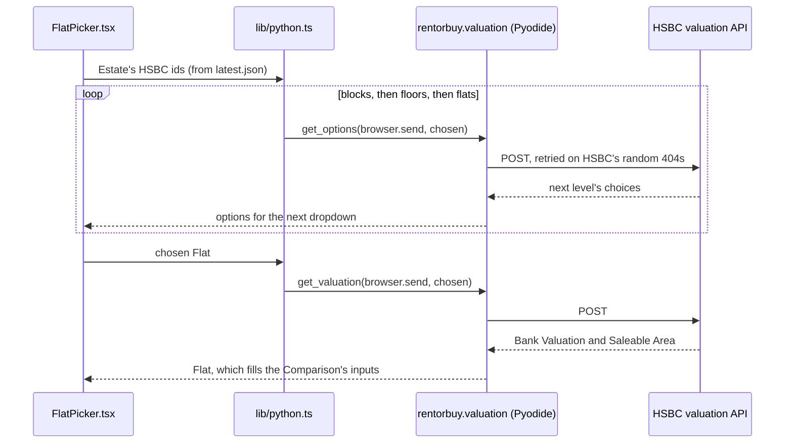

# web — the page (it only displays)

> **摘要**：React + TypeScript + Tailwind + shadcn/ui 嘅網站，由 Vite build，`deploy.yml` 放上 GitHub Pages。
> 佢只係將資料傳入 Python、再顯示 Python 回傳嘅結果；所有計數喺 `rentorbuy/calc/`，因為 TypeScript 冇分。

**Does:** read `data/latest.json`, collect the visitor's inputs, call our Python through Pyodide, draw the
results (`App.tsx`, `components/`).
**Does not:** calculate. `src/lib/format.ts` only turns numbers into text.

## Where the Python comes from

`scripts/copy-python.mjs` runs before `dev` and `build`. It copies `rentorbuy/calc/*.py`,
`rentorbuy/valuation.py`, `rentorbuy/browser.py` and `data/latest.json` into `public/` (ignored by git;
edit the originals). `src/lib/python.ts` loads Pyodide from jsDelivr, writes those files into it, and calls
`rentorbuy.compare_scenarios` for the Comparison and `rentorbuy.recommend_estates` for Estate-level
affordability suggestions. The recommender uses only Estate averages and available bedroom averages;
it does not imply individual Flat listings.

## The flat picker



## Rules that must hold

- When the page needs a new number, add it to what `rentorbuy.compare()` returns and display it here.
- Python files are fetched with `cache: "no-cache"`, so a new deploy never runs old Python.

## Run it

```bash
pnpm --dir web install
pnpm --dir web dev     # http://localhost:5173
pnpm --dir web build
pnpm --dir web lint
```
